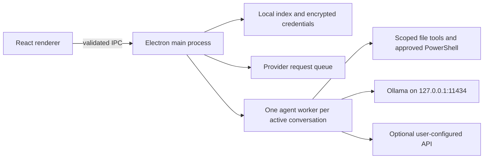

# LocalCode

**English** | [简体中文](README.zh-CN.md)

A local-first coding desktop for Windows: Electron + React + TypeScript, a separate agent worker for each conversation, and Ollama inference on your own computer. Read and edit project files, review changes, approve terminal commands, and resume saved conversations in Simplified Chinese, English, Japanese, or Korean. Optional external providers support OpenAI Chat Completions, Responses, and Anthropic Messages.

This repository contains the application architecture, source, tests, dependency lockfile, and bootstrap scripts.

Tasks can start without a project folder. Choose a workspace above the composer when needed, or move an existing projectless task into a project while keeping its conversation. Projects support pinning and collapsible task groups; sidebar preferences persist. File names open inline, and copy is available once per final answer. See [tasks and projects](docs/TASKS_AND_PROJECTS.md).

Conversation text uses the system sans-serif font, with a 14 px default size, 24 px line height, and 12 px paragraph spacing. Font size remains adjustable in Settings → Appearance. Stop status and elapsed time share one line; completed runs show elapsed time before the final reply. File cards show three files initially and expand to reveal the rest. Routine coverage notes are hidden, while actual statistics errors remain visible.

> **Release hold:** the known application-data isolation issue remains unresolved. Previous validation artifacts are not recommended releases; passing build or onboarding checks does not establish release readiness.

## Interface and reply language

Open **Settings → Language** (initially **设置 → 语言**) to choose **简体中文 / English / 日本語 / 한국어**. The interface updates immediately and the choice is saved across restarts. Existing conversations use the new default reply language from their next turn; an active turn keeps its starting language. Explicit reply or translation language requests take priority: a Chinese question asking for an English answer should receive English. User messages, model responses, code, file paths, and tool output are preserved in their original language.

The language policy is verified through request capture with a local mock model; live model compliance has not been evaluated in this change.

## Quick start: choose the download that fits you

Use **Windows 11 x64** (Windows 10 22H2 x64 is an upstream-compatible target, untested here). Extract the **complete folder** to a writable local directory such as `D:\LocalCode`, not inside the ZIP, a protected system directory, or a network share. **You do not need to install Node.js, npm or Git, and administrator rights are not required.**

| What you downloaded | How to recognize it | First step |
| --- | --- | --- |
| **Source ZIP** from GitHub **Code → Download ZIP** (or an automatically generated “Source code” archive) | Contains `LocalCode/source/package.json`; no packaged desktop | Run `Setup.cmd`; choose **2 — Desktop only** for a cloud API or an existing Ollama service |
| **Portable desktop** from a successful Actions run | The inner app ZIP contains `READ-ME-FIRST.txt` and `LocalCode/app/current.txt` | Extract both ZIP layers, then run `Start.cmd` |

If no successful, unexpired artifact is listed, there is no portable download for that run. Renaming a source ZIP or copying a launcher will not make it runnable.

**Which environments are actually needed?**

| Component | Portable desktop / cloud API | Source setup or optional use |
| --- | --- | --- |
| Node.js / npm | Not required separately; Electron is packaged | `Setup.cmd` downloads a private portable copy automatically |
| Git | Not required | Only needed if you choose to clone or contribute, not for a source ZIP |
| Python | Not required | Used by the maintainer release scanner or by projects that need it; not an onboarding prerequisite |
| Ollama / local model / GPU setup | Not required for a cloud API | Only for local inference; use an existing Ollama or explicitly install the managed model |
| Windows PowerShell 5.1+ | Needed for approved PowerShell commands and managed-service actions | Needed by setup; use the Windows-provided `powershell.exe` |

Opening LocalCode does not install your project's language runtimes or build tools. A Python, Node.js or other project may have its own prerequisites even though the desktop itself does not need them installed globally.

### Prebuilt portable desktop: extract and open

A successful **Source checks** workflow produces the **`LocalCode-windows-x64`** Actions artifact. Downloading an Actions artifact requires a GitHub sign-in. The artifact contains `LocalCode-0.1.19-windows-x64.zip` and `SHA256SUMS.txt`; extract the artifact first, then extract the inner application ZIP. A workflow artifact is a validation build, **not a published GitHub Release**; availability depends on that workflow completing successfully and its retention period.

1. Double-click the extracted **`Start.cmd`**. No build tools or model downloads are needed to open the desktop.
2. Choose your connection in Settings:
   - **Already have Ollama?** Explicitly select the existing local service and choose one of its installed models. LocalCode will not install, replace or stop it.
   - **Use your own API?** Configure that provider. Saving configuration does not make a model request; an explicit connection test or task may use quota.
   - **Want LocalCode's managed local model?** Close LocalCode, then double-click **`Install-LocalModel.cmd`**. This downloads checksum-pinned Ollama 0.40.10 and `qwen3.5:9b-q4_K_M`, with the `localcode-agent` alias at 8192-token context. It does **not** download Node.js or rebuild the desktop. Allow several GB of downloads and preferably **25 GiB free**; check the hardware guidance below before choosing the 9B model.
3. Start a conversation directly, or select a project folder for a coding task. Projectless conversations have no file or terminal tools; project terminal commands require explicit approval.

Opening the desktop never silently starts or reuses an Ollama service. For a managed installation after reboot, use the explicit local-service start action in Settings (or `Ollama\Start.cmd`). Closing LocalCode leaves an already running managed Ollama available; idle models unload after five minutes. `Ollama\Stop.cmd` stops only the managed process whose executable path matches this installation.

**Updating an existing installation:** close LocalCode and keep a private backup of the complete old folder, including `LocalCode/data`. Extract a new portable ZIP into a **new folder first**. A fresh folder starts with fresh history/settings; there is no automatic migration between folders. An empty conversation list in the new folder does not mean the old data was deleted. Keep the original and backup until migration has been separately verified; do not overwrite/delete data or copy individual index/credential files blindly. Do not assume stored API keys transfer to another Windows account or computer; re-enter them in Settings if needed. Never upload the old folder with a bug report because it can contain conversations and credentials. Changing the model/provider within an existing installation keeps its saved conversation history.

### Source ZIP: setup handles the build tools

Download and extract the repository's source ZIP, or clone it if you already use Git. Double-click **`Setup.cmd`** and choose:

| Choice | What it prepares | Suggested free disk |
| --- | --- | --- |
| **1 — Local model + desktop** | Portable Node.js, locked dependencies, checks/build/package, managed Ollama and the default local model | **25 GiB**, more for larger models |
| **2 — Desktop only** | Portable Node.js, locked dependencies, checks/build/package; no Ollama runtime or model download | **5 GiB** |
| **3 — Exit** | Nothing | — |

After setup succeeds, double-click **`Start.cmd`**. Setup displays its current stage and keeps the window open on success or failure. It checks Windows x64, extracted files, write access, disk space and managed-service port conflicts before expensive work. Low space below the recommendation produces a warning; less than 1 GiB is blocked. Requirements vary with caches and model size, so these checks are not a guarantee that a model fits. No purchases or API credentials are requested by setup.

For command-line use, supplied options bypass the menu:

```powershell
# Source only: build the desktop without downloading a local model.
.\Setup.cmd -BuildOnly
# Source: full local setup, with an explicit model choice.
.\Setup.cmd -Model qwen3.5:9b-q4_K_M
# Prebuilt desktop: add only the managed local model.
.\Install-LocalModel.cmd
```

Preview any mode **without downloads, service starts or filesystem writes**:

```powershell
.\Setup.cmd -Plan
.\Setup.cmd -BuildOnly -Plan
.\Install-LocalModel.cmd -Plan
```

### First cloud API connection (no local model needed)

Use the endpoint, API format, model ID and API key supplied by your provider; LocalCode does not create an account or supply API credit. The desktop UI is Chinese:

1. Open **设置 → 模型设置 → 自定义 API** (Settings → Model Settings → Custom API). Use **火山 Coding Plan** only when that is your provider/plan.
2. Enter **供应商名称**, **Base URL**, **API 格式**, **API Key** and **模型 ID**. Use the provider's API endpoint, not its website or chat page. Do not paste a full `/chat/completions`, `/responses` or `/messages` request URL. The connection test appends `/chat/completions` or `/responses` for the corresponding OpenAI formats, and `/v1/messages` for Anthropic, so do not duplicate those path segments.
3. Set context/output limits to values supported by your model; output limit **plus 1536 must be less than** the context window. Keep the provider and model enabled, then click **保存配置**. Saving does not send a model request.
4. Optionally click the model's **plug icon** to test the saved connection. This sends a small request and may consume quota. A green configuration dot alone does not prove connectivity; a successful connection test does not prove tool-calling support.
5. Close Settings and **select the saved provider/model below the chat input**. Saving a provider does not switch the active model. The status should say **云端模式 · 无需 Ollama**; a missing local Ollama service does not block this choice.

Do not put an API key in a URL, project file, screenshot or bug report. Provider requests can include prompts, project context and tool results; only use a provider you intend to share them with.

### If setup needs attention

| Message / situation | What to do |
| --- | --- |
| PowerShell is missing / unsupported platform | Use Windows x64 with built-in Windows PowerShell 5.1 or later. ARM64, 32-bit Windows, macOS and Linux are not supported by these launchers. |
| Files missing / executable missing | Extract the entire correct ZIP, not just a launcher. Source ZIP users run `Setup.cmd`; prebuilt users do not need a source build. |
| Folder is not writable / low disk space | Move the complete folder to a writable local disk or free space yourself. Do not run as administrator just to work around the location. Nothing is automatically deleted. |
| `curl.exe` missing | No action needed: the installer uses Windows PowerShell's built-in HTTPS downloader instead. |
| Download / npm failure | Read the failing stage and host. Check connectivity, proxy or organization policy for `nodejs.org`, `registry.npmjs.org`, GitHub and Ollama's model registry as applicable, then rerun the **same installer with the same options**. Do not disable certificate checks or the firewall. |
| Checksum mismatch / incomplete extraction | The installer refuses to use or overwrite the suspect file/directory. Inspect the named path, move it aside yourself and retry. Integrity checks are never skipped. |
| Cannot verify listener ownership | The installer stops rather than trusting an unrelated process. Use built-in Windows PowerShell with its NetTCPIP diagnostics available; ask your administrator to restore missing system components if needed. |
| Port 11434 is already occupied | No unrelated process is stopped or reused. Either keep your existing Ollama and explicitly configure it in Settings, or exit it yourself before installing the managed model. Source users can choose desktop-only setup. |
| Model download interrupted | Rerun `Install-LocalModel.cmd` for a prebuilt app, or the same source `Setup.cmd` options. Ollama resumes model downloads; failed runtime archives may download again. |
| Cloud model saved, but `Ollama 未连接` is still shown | Select the saved cloud provider/model below the chat input; saving does not select it for you. Do not install Ollama just to use a cloud API. |
| Cloud test button is disabled | Save pending edits, enter/save the API key, and enable both the provider and model. Wait for any current test/save to finish. |
| Cloud test reports HTTP 401 / 403 | Check the key and that account/plan's access to the chosen model. Do not share the key when asking for help. |
| Cloud test reports HTTP 404 or response-format mismatch | Check the Base URL, API format and exact model ID against your provider's API documentation. Do not include the full request path in Base URL. |
| Cloud test reports HTTP 429 | Check the provider's rate limit and remaining quota; wait before retrying. Repeated tests can also consume quota. |
| Cloud connection fails or exceeds 30 seconds | Check connectivity to your configured provider, the Base URL and provider status. Do not disable certificate checks or system protection. |

Initial downloads need internet access and can take time; model inference itself can run locally afterward. Close LocalCode before rerunning either installer. Keep the displayed error if you need help. The installer preserves existing data and does not change global environment variables, firewall settings or Windows services.

## Devices and model choices

**Verified reference device:** Windows 11 x64, Intel Core Ultra 5 125H, approximately 24 GB installed RAM (23.5 GiB reported), NVIDIA GeForce RTX 4060 Laptop GPU with 8188 MiB VRAM, driver 572.60. Historical local acceptance used Qwen3.5 9B Q4_K_M at 8K context and reported full GPU loading. This is a reference configuration, not a minimum-performance guarantee. The sanitized open-source build has its own validation status in [the release review](docs/RELEASE_REVIEW.md).

| Device | Deployment guidance | Validation |
| --- | --- | --- |
| Windows x64 + NVIDIA 8 GB VRAM + 24 GB RAM | Default 9B Q4_K_M, 8K context; close GPU-heavy apps | Reference hardware; fresh model download/inference not repeated for this release |
| Windows x64 + 4–6 GB VRAM or 16 GB RAM | Try a smaller tool-capable 2B/4B model; start at 4K context | Estimate; not benchmarked |
| Windows x64, CPU only | Use a smaller model; generation can be substantially slower | CPU fallback observed historically; no latency promise |
| Windows x64 + 12–16 GB VRAM, 32 GB+ RAM | More room for higher precision, context, or a larger suitable model | Capacity guidance, not a tested fit guarantee |
| Windows x64 + 24 GB+ VRAM, 48–64 GB+ RAM | Consider larger 27B/32B-class quantized models after checking their actual size and tool support | Not tested here |
| AMD / Intel GPU, Windows ARM64, macOS, Linux | Ollama supports additional hardware upstream; this Windows x64 bootstrap and desktop workflow have not been validated on these targets | Not supported by this bootstrap |

**Hardware above the reference device can deploy larger and potentially more capable local models.** More VRAM allows larger weights and KV cache, while RAM and disk capacity also matter. A bigger model does not automatically produce better coding results; evaluate tool calling, correctness, latency, and memory use on your tasks. MoE active parameter count does not equal total weight memory. Longer context and concurrent inference consume extra memory.

For initial managed-model provisioning in a **fresh source folder**, for example:

```powershell
# Smaller hardware: example candidate, not an accepted coding benchmark.
powershell -NoProfile -ExecutionPolicy Bypass -File .\Setup.ps1 -Model qwen3.5:4b -Context 4096 -MaxTokens 512

# Larger hardware: example candidate; verify fit before downloading.
powershell -NoProfile -ExecutionPolicy Bypass -File .\Setup.ps1 -Model qwen3.5:27b -Context 8192 -MaxTokens 1024
```

Managed local setup creates `localcode-agent` pointing to your selected model. The existing-Ollama connection instead uses an installed model you explicitly select. Initial context and output budgets are saved in `LocalCode/model-profile.json` and read when creating the app's first data index. Later, Settings can change the installed model selection and the app's context/output budgets without deleting conversation history. New turns use the updated settings; a turn already running keeps its captured settings. The app context budget does **not** change Ollama's actual `num_ctx`; do not set it above the server/model's configured context. The installer still refuses to replace a saved deployment profile with incompatible budgets when app data exists; provision a different managed alias budget in a fresh folder rather than overwriting old data. Setup records installation metadata locally and labels inference acceptance `UNRUN`; installation success alone is not a model capability test.

Windows and GPU requirements are based on [Ollama's Windows documentation](https://docs.ollama.com/windows) and [hardware support](https://docs.ollama.com/gpu). The pinned portable runtime contains NVIDIA dependencies; AMD/Intel support requires separate upstream setup. See the [default model page](https://ollama.com/library/qwen3.5:9b-q4_K_M) for current model size and license. Registry tags can change; setup records the installed alias and the verification script reports its digest.

## Turn summaries and file previews (0.1.13)

- Each completed task turn keeps its own elapsed time and file-change summary. Intermediate replies remain copyable without marking the turn complete; stopped or failed turns keep their actual status. Repeated writes to one file are counted once, and edits restored to their starting content are omitted.
- Click a generated file link to view HTML, images, or text inside the agent. Right-click file links, tool file entries, or changed files to preview, inspect source, open with the default or another Windows app, reveal in Explorer, or copy the full path. PDFs and other documents use external applications.
- HTML previews run interactive local scripts with project-relative assets in an isolated frame. Network requests and access to the agent are blocked. File statistics use bounded project snapshots, so coverage limits and concurrent external edits are shown explicitly.

See [turn summaries and previews](docs/TURN_SUMMARIES_AND_PREVIEWS.md) for usage, scope, and validation commands.

## Architecture



- Renderer: isolated, sandboxed Electron window without Node.js access.
- Main process: validates IPC, encrypts provider credentials with Windows-backed Electron `safeStorage`, persists sessions, coordinates approvals and cancellation, and schedules requests.
- Agent workers: pinned pi SDK 1.4.0; bounded tool loops; independent cancellation and approvals per conversation.
- Workspace: UTF-8 text tools with path/link checks, snapshots, conflict-aware undo, and visible diffs. File tools can edit without a second approval; every terminal command requires approval.
- Models: local Ollama by default; optional API configuration in Settings. Saving API configuration does not call a provider. Explicit connection tests and tasks may consume quota.
- Optional companion: import your own licensed sprite atlas (1536 × 2288 RGBA PNG, 8 × 11 grid). No character artwork is distributed; companions start disabled.

## Development

```powershell
cd LocalCode\source
npm ci
npm run typecheck
npm test -- --no-file-parallelism
npm run build
npm start
npm run package
cd ..\..
# From the repository root: offline setup smoke tests (Windows PowerShell 5.1).
powershell -NoProfile -ExecutionPolicy Bypass -File scripts\Test-Setup.ps1
```

Use Node.js 24 x64 for manual development; source setup downloads it automatically. The lockfile defines exact dependency versions. Packaging is Windows x64 and writes a versioned directory without overwriting a different build. Direct `npm start` uses Electron's per-user data directory unless `LOCALCODE_HOME` is set; use the root launcher for the portable directory layout.

| Location | Purpose | Published? |
| --- | --- | --- |
| `LocalCode/source/src`, `tests`, `scripts` | Implementation, tests, build and simulated acceptance | Yes |
| `Setup.ps1`, `Ollama/*.ps1`, launchers | Portable deployment helpers | Yes |
| `LocalCode/data`, `cache`, `logs`, `evidence`, `app` | Credentials, conversations, snapshots, caches, test output, executables | No |
| `Ollama/models`, `runtime`, `profile`, `logs`, `downloads`, `temp` | Weights, binaries, private profile, runtime data | No |
| `tools`, `downloads` | Portable Node.js and downloaded archives | No |

## Security, privacy, and licenses

Read [SECURITY.md](SECURITY.md) before using the agent on important files. Terminal commands run with your Windows account's permissions; the app is not an OS sandbox. Approved commands can read outside the project or send data over the network. Provider requests include prompts, context, and tool results. Local conversation history and snapshots are not encrypted by default. Never commit runtime directories, even when credentials appear encrypted.

Before publishing changes, stage only intended source files and run:

```powershell
python scripts\release_scan.py --self-test
python scripts\release_scan.py
```

The scanner inspects exact staged blobs, blocks runtime/credential artifacts, and detects several secret formats. It is a guardrail, not a complete security audit. CI repeats this check; maintainers must also review code, licenses, and dependency advisories. See [release review](docs/RELEASE_REVIEW.md).

Source: [MIT](LICENSE). Dependencies retain their own licenses. Qwen weights and Ollama are fetched from upstream and are not redistributed by this repository. See [third-party notices](THIRD_PARTY_NOTICES.md). The application is unsigned; Windows may show a reputation warning.
