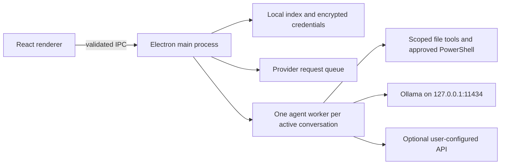

# LocalCode

**English** | [简体中文](README.zh-CN.md)

A local-first coding desktop for Windows: Electron + React + TypeScript, a separate agent worker for each conversation, and Ollama inference on your own computer. Read and edit project files, review changes, approve terminal commands, and resume saved conversations in a Chinese-language desktop UI. Optional external providers support OpenAI Chat Completions, Responses, and Anthropic Messages.

This repository contains the application architecture, source, tests, dependency lockfile, and bootstrap scripts. Your API keys, conversations, project snapshots, logs, browser profile, installed applications, and model weights are **not included**.

## Quick start

1. Use **Windows 11 x64** (Windows 10 22H2 x64 is an upstream-compatible target, untested here). Keep at least **25 GB free** for dependencies, portable runtimes, build output, and a 9B model. Internet access is needed for initial downloads.
2. Clone this repository, or download and extract its source ZIP to a writable local directory. Avoid protected system directories and network shares.
3. Double-click **`Setup.cmd`**. It downloads checksum-pinned portable Node.js 24.14.0 and Ollama 0.40.10, installs locked npm dependencies, checks/types/tests/builds/packages LocalCode, pulls `qwen3.5:9b-q4_K_M`, and creates the `localcode-agent` alias with an 8192-token context. No administrator rights or API key are required.
4. Double-click **`Start.cmd`**, open a project folder, and send a small coding task. Terminal commands require explicit approval.

```powershell
git clone https://github.com/Sinfony8838/LocalCode.git
cd LocalCode
.\Setup.cmd
.\Start.cmd
```

Initial setup downloads several GB and can take time. Interrupted model downloads can be resumed by rerunning setup. Close LocalCode before rerunning setup. An existing, unrelated service on port 11434 is never killed or silently used by setup: stop it yourself or use a separate machine. Do not run this clone's Ollama alongside another instance on the same port.

To preview setup without downloads or writes:

```powershell
powershell -NoProfile -ExecutionPolicy Bypass -File .\Setup.ps1 -Plan
```

`-BuildOnly` builds the desktop without installing Ollama or downloading a model. It still downloads Node.js and npm dependencies. `Ollama\Stop.cmd` stops only the managed Ollama process whose executable path matches this installation. Closing LocalCode leaves Ollama available; idle models unload after five minutes.

## Devices and model choices

**Verified reference device:** Windows 11 x64, Intel Core Ultra 5 125H, approximately 24 GB installed RAM (23.5 GiB reported), NVIDIA GeForce RTX 4060 Laptop GPU with 8188 MiB VRAM, driver 572.60. Historical local acceptance used Qwen3.5 9B Q4_K_M at 8K context and reported full GPU loading. This is a reference configuration, not a minimum-performance guarantee. The sanitized open-source build has its own validation status in [the release review](docs/RELEASE_REVIEW.md).

| Device | Deployment guidance | Validation |
| --- | --- | --- |
| Windows x64 + NVIDIA 8 GB VRAM + 24 GB RAM | Default 9B Q4_K_M, 8K context; close GPU-heavy apps | Reference hardware; fresh model download/inference not repeated for this release |
| Windows x64 + 4–6 GB VRAM or 16 GB RAM | Try a smaller tool-capable 2B/4B model; start at 4K context | Estimate; not benchmarked |
| Windows x64, CPU only | Use a smaller model; generation can be substantially slower | CPU fallback observed historically; no latency promise |
| Windows x64 + 12–16 GB VRAM, 32 GB+ RAM | More room for higher precision, context, or a larger suitable model | Capacity guidance, not a tested fit guarantee |
| Windows x64 + 24 GB+ VRAM, 48–64 GB+ RAM | Consider larger 27B/32B-class quantized models after checking their actual size and tool support | Not tested here |
| AMD / Intel GPU, Windows ARM64, macOS, Linux | Ollama supports additional hardware upstream; this Windows x64 bootstrap and desktop workflow have not been validated on these targets | Not supported by this bootstrap |

**Hardware above the reference device can deploy larger and potentially more capable local models.** More VRAM allows larger weights and KV cache, while RAM and disk capacity also matter. A bigger model does not automatically produce better coding results; evaluate tool calling, correctness, latency, and memory use on your tasks. MoE active parameter count does not equal total weight memory. Longer context and concurrent inference consume extra memory.

To choose a different model and budgets on a **fresh clone**, for example:

```powershell
# Smaller hardware: example candidate, not an accepted coding benchmark.
powershell -NoProfile -ExecutionPolicy Bypass -File .\Setup.ps1 -Model qwen3.5:4b -Context 4096 -MaxTokens 512

# Larger hardware: example candidate; verify fit before downloading.
powershell -NoProfile -ExecutionPolicy Bypass -File .\Setup.ps1 -Model qwen3.5:27b -Context 8192 -MaxTokens 1024
```

The desktop always targets `localcode-agent`; setup points that alias to your selected model. Context and output budgets are saved in `LocalCode/model-profile.json` and read when creating the app's first data index. Existing conversations retain their stored profile. Use a fresh clone for different budgets; setup refuses incompatible changes when application data already exists. Setup records installation metadata locally and labels inference acceptance `UNRUN`; installation success alone is not a model capability test.

Windows and GPU requirements are based on [Ollama's Windows documentation](https://docs.ollama.com/windows) and [hardware support](https://docs.ollama.com/gpu). The pinned portable runtime contains NVIDIA dependencies; AMD/Intel support requires separate upstream setup. See the [default model page](https://ollama.com/library/qwen3.5:9b-q4_K_M) for current model size and license. Registry tags can change; setup records the installed alias and the verification script reports its digest.

## Architecture



- Renderer: isolated, sandboxed Electron window without Node.js access.
- Main process: validates IPC, encrypts provider credentials with Windows-backed Electron `safeStorage`, persists sessions, coordinates approvals and cancellation, and schedules requests.
- Agent workers: pinned pi SDK 1.4.0; bounded tool loops; independent cancellation and approvals per conversation.
- Workspace: UTF-8 text tools with path/link checks, snapshots, conflict-aware undo, and visible diffs. File tools can edit without a second approval; every terminal command requires approval.
- Models: local Ollama by default; optional API configuration in Settings. Saving API configuration does not call a provider. Explicit connection tests and tasks may consume quota.
- Optional companion: import your own licensed sprite atlas (1536 × 2288 RGBA PNG, 8 × 11 grid). No character artwork is distributed; companions start disabled.

## Development

```powershell
cd LocalCode\source
npm ci
npm run typecheck
npm test -- --no-file-parallelism
npm run build
npm start
npm run package
```

Use Node.js 24 x64. The lockfile defines exact dependency versions. Packaging is Windows x64 and writes a versioned directory without overwriting a different build. Direct `npm start` uses Electron's per-user data directory unless `LOCALCODE_HOME` is set; use the root launcher for the portable directory layout.

| Location | Purpose | Published? |
| --- | --- | --- |
| `LocalCode/source/src`, `tests`, `scripts` | Implementation, tests, build and simulated acceptance | Yes |
| `Setup.ps1`, `Ollama/*.ps1`, launchers | Portable deployment helpers | Yes |
| `LocalCode/data`, `cache`, `logs`, `evidence`, `app` | Credentials, conversations, snapshots, caches, test output, executables | No |
| `Ollama/models`, `runtime`, `profile`, `logs`, `downloads`, `temp` | Weights, binaries, private profile, runtime data | No |
| `tools`, `downloads` | Portable Node.js and downloaded archives | No |

## Security, privacy, and licenses

Read [SECURITY.md](SECURITY.md) before using the agent on important files. Terminal commands run with your Windows account's permissions; the app is not an OS sandbox. Approved commands can read outside the project or send data over the network. Provider requests include prompts, context, and tool results. Local conversation history and snapshots are not encrypted by default. Never commit runtime directories, even when credentials appear encrypted.

Before publishing changes, stage only intended source files and run:

```powershell
python scripts\release_scan.py --self-test
python scripts\release_scan.py
```

The scanner inspects exact staged blobs, blocks runtime/credential artifacts, and detects several secret formats. It is a guardrail, not a complete security audit. CI repeats this check; maintainers must also review code, licenses, and dependency advisories. See [release review](docs/RELEASE_REVIEW.md).

Source: [MIT](LICENSE). Dependencies retain their own licenses. Qwen weights and Ollama are fetched from upstream and are not redistributed by this repository. See [third-party notices](THIRD_PARTY_NOTICES.md). The application is unsigned; Windows may show a reputation warning.
